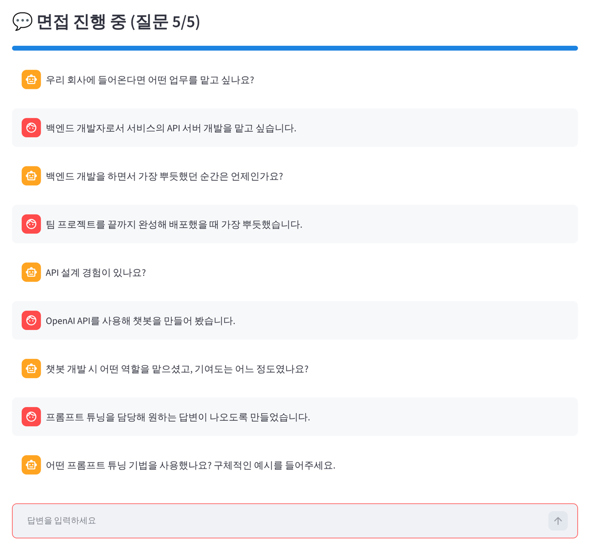

# Oreum · AI 채팅 면접 플랫폼

AI 면접관이 지원자의 답변을 읽고 꼬리 질문을 이어 가고, 답변을 4개 항목으로 자동 채점하는 기업 · 지원자용 채팅 면접 플랫폼입니다.

> 2025.10 · 팀 프로젝트 (2인) · 주제 선정, 기획, 백엔드 개발, 발표 자료 담당



지원자 채팅 면접 화면. AI 면접관이 직전 답변에 나온 프로젝트 · 기술을 짚어 꼬리 질문을 이어 갑니다.

## 주요 기능

**기업**
- 직무별 8자리 1회용 면접 코드 발급 (응시가 끝나면 자동으로 사용 처리)
- 직무별 면접 질문 등록 · 삭제
- 지원자 현황 · 문항별 답변과 점수 조회, 직무별 평균 점수 비교, 엑셀 내보내기
- 답변 키워드로 지원자에게 맞는 직무 3개 추천

**지원자**
- 실전 면접: 면접 코드 입력 → AI 면접관과 채팅 면접 5문항 (점수는 기업에만 저장)
- 연습 면접: 자기소개서 분석, 답변마다 즉시 점수와 보완 피드백

## 동작 방식

1. **첫 질문**: 기업이 등록한 질문이 있으면 먼저 사용하고, 없으면 자기소개서에서 뽑은 핵심역량으로 맞춤 질문을 만듭니다.
2. **꼬리 질문**: Gemini가 직전 답변을 읽고 규칙에 따라 50자 이내로 질문합니다.
   - 답변이 짧으면 구체적인 사례를 묻기
   - 프로젝트가 나오면 역할과 기여도를 묻기
   - 기술이 나오면 실제 사용 경험을 묻기
3. **채점**: 답변마다 규칙 기반으로 4개 항목을 각 25점, 총 100점으로 채점합니다. 같은 답변은 항상 같은 점수를 받습니다.

| 항목 | 기준 |
| --- | --- |
| 명확성 | 답변 길이, 문장 수, 군더더기 말 감점 |
| 전문성 | 직무별 키워드 사전과 일치하는 기술 용어 |
| 구체성 | 경험 키워드, 숫자 · 단위, 구체적 사례 |
| 적합성 | 역할 · 기여 · 성과 키워드, 협업 언급 |

4. **예외 처리**: Gemini 호출이 실패하면 직무별 기본 질문으로 바로 대체해 면접이 끊기지 않습니다.

## 기술 스택

Python · Streamlit · Google Gemini 2.0 Flash · pandas · openpyxl · Plotly · JSON 파일 저장

## 구조

```
app/
├── main.py             # 진입점, 로그인 상태 · 사용자 유형별 화면 분기
├── auth.py             # 기업 가입 · 로그인(SHA-256), 면접 코드 확인
├── company_pages.py    # 기업 대시보드
├── interview_pages.py  # 실전 면접
├── practice_pages.py   # 연습 면접
├── ai_engine.py        # Gemini 질문 생성 · 자기소개서 분석
├── evaluation.py       # 4항목 규칙 기반 채점
├── config.py           # 직무 키워드 · 문항 수 · 합격 기준
└── utils.py            # JSON 읽기 · 쓰기, 코드 생성
```

## 실행 방법

```bash
pip install -r requirements.txt
export GEMINI_API_KEY=발급받은_키   # Windows: set GEMINI_API_KEY=발급받은_키
cd app
streamlit run main.py
```

API 키가 없으면 AI 질문 대신 직무별 기본 질문으로 동작합니다. 기업 · 면접 코드 · 면접 기록은 실행 폴더에 JSON 파일로 저장됩니다.
